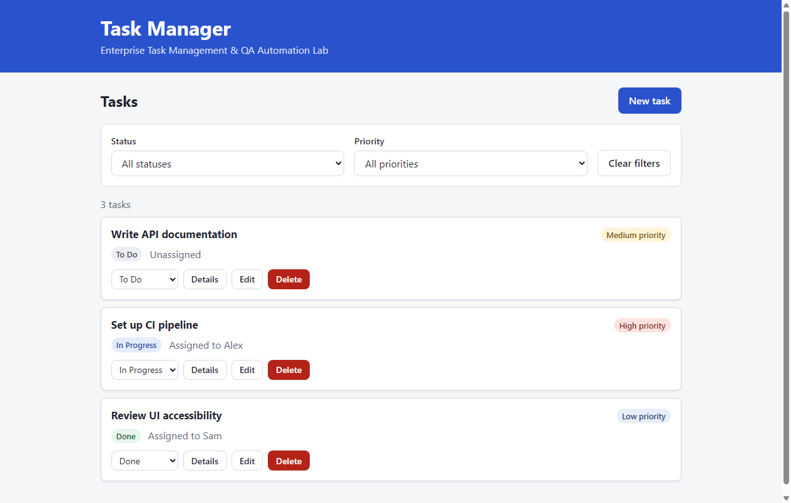
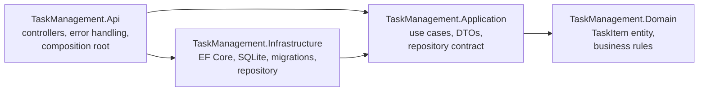
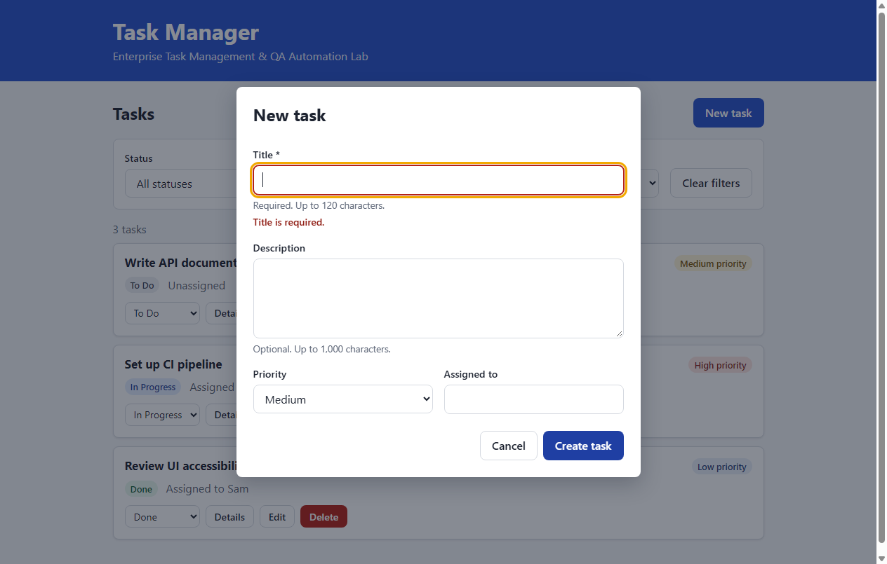
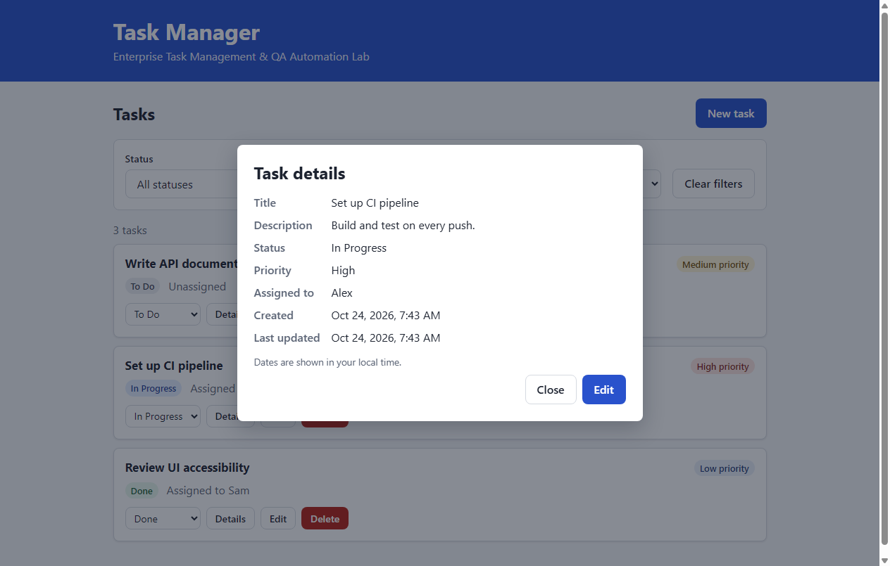
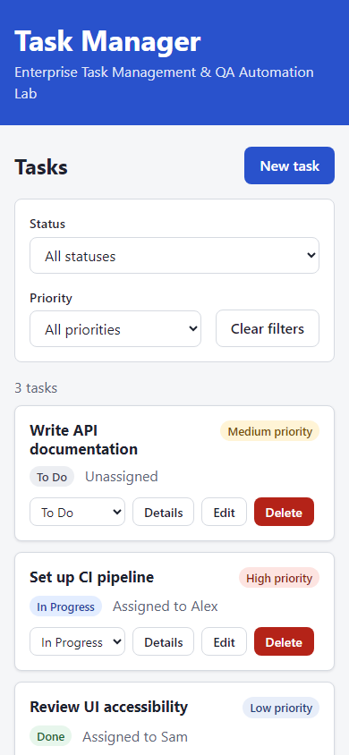

# Enterprise Task Management & QA Automation Lab

A small, production-inspired task management application built with ASP.NET Core, Entity Framework Core and SQLite, together with a layered automated test strategy (unit, integration and browser tests).

> **About this project.** This is a personal portfolio exercise, developed with AI-assisted development. Its goal is to demonstrate software engineering and QA automation practices: layered architecture, RESTful API design, persistence, validation, error handling, automated testing, documentation and CI. It has not been deployed to production.

> **Status: work in progress.** The backend, the web frontend and the three automated test suites (unit, integration and Selenium) are implemented. The CI pipeline and the QA documentation are next. See [Project status](#project-status).



## Contents

- [Technology stack](#technology-stack)
- [Architecture](#architecture)
- [Features](#features)
- [Screenshots](#screenshots)
- [REST API](#rest-api)
- [Getting started](#getting-started)
- [Database](#database)
- [Running the tests](#running-the-tests)
- [Project status](#project-status)
- [Known limitations](#known-limitations)
- [Future improvements](#future-improvements)

## Technology stack

| Area | Technology |
|---|---|
| Backend | C#, .NET 10 (LTS), ASP.NET Core Web API (controllers) |
| Persistence | Entity Framework Core 10, SQLite, EF Core migrations |
| API documentation | Built-in OpenAPI (`Microsoft.AspNetCore.OpenApi`) |
| Frontend | HTML5, CSS3, vanilla JavaScript (ES modules, no framework or build step) |
| Testing | NUnit; ASP.NET Core `WebApplicationFactory` with SQLite in-memory; Selenium WebDriver with headless Chrome |
| DevOps | Git, GitHub, GitHub Actions *(planned)*, .NET CLI, NuGet |

No third-party libraries are used beyond the Microsoft packages listed above; for example, mapping is written by hand and tests use hand-written fakes instead of a mocking library.

## Architecture

The solution follows a layered architecture in which dependencies point inward: the domain has no dependencies at all, and infrastructure details (EF Core, SQLite) can be replaced without touching business rules.



| Project | Responsibility |
|---|---|
| `src/TaskManagement.Domain` | `TaskItem` entity and its invariants (title rules, default status, timestamps). No framework code. |
| `src/TaskManagement.Application` | `TaskService` use cases, request/response DTOs, the `ITaskRepository` contract and `NotFoundException`. |
| `src/TaskManagement.Infrastructure` | `AppDbContext`, entity configuration, `TaskRepository`, migrations and development seed data. |
| `src/TaskManagement.Api` | HTTP endpoints, global exception handling (ProblemDetails), dependency injection and OpenAPI. Also serves the frontend from `wwwroot`. |
| `src/TaskManagement.Api/wwwroot` | Single-page frontend: `index.html`, `css/styles.css`, `js/api.js` (HTTP client) and `js/app.js` (UI logic). |
| `tests/TaskManagement.UnitTests` | NUnit tests for the domain and the application service. |
| `tests/TaskManagement.IntegrationTests` | HTTP tests against the real API hosted in memory, with an isolated database per test. |
| `tests/TaskManagement.UITests` | Selenium browser tests (Page Object Model) against the API running as a separate process. |

Key design decisions:

- **Rich domain entity.** `TaskItem` exposes no public setters; all changes go through methods that validate input first. The identifier therefore cannot be changed after creation, and a failed update leaves the task untouched.
- **Validation in two layers.** DataAnnotations on the DTOs reject malformed requests at the HTTP boundary, while the domain enforces the same rules as invariants regardless of the caller. Length limits are defined once, as constants on `TaskItem`.
- **Deterministic time.** The domain receives the current UTC time as a parameter, and the application layer reads it from .NET's built-in `TimeProvider`, so timestamp behavior is tested without delays.
- **Centralized error handling.** A single `IExceptionHandler` converts exceptions into [RFC 9457](https://www.rfc-editor.org/rfc/rfc9457) ProblemDetails responses. Unexpected errors return a generic 500 message; details are only logged on the server.
- **Frontend served by the API.** The page and the API share one origin, so no CORS configuration is needed and a single process serves everything (which also simplifies browser tests). A framework was not needed for one screen with a few dialogs.
- **XSS-safe rendering.** Tasks are rendered by cloning a `<template>` and assigning `textContent`; user input is never inserted as HTML.

## Features

Available both in the web interface and through the REST API:

- Create, list, view, edit and delete tasks.
- Change a task's status (`ToDo`, `InProgress`, `Done`).
- Set a priority (`Low`, `Medium`, `High`) and an optional assignee.
- Filter tasks by status and/or priority.

Web interface:

- Responsive layout, from phones (320px) to desktop.
- Create/edit form with client-side validation; errors are shown next to each field, and server-side validation errors are mapped to the same fields.
- Task details dialog, with dates shown in the user's local time.
- Status change directly from each task card; a failed change reverts to the saved status.
- Delete confirmation dialog, with focus starting on "Cancel".
- Success and error messages in a live region announced by screen readers.
- Keyboard accessible: native `<dialog>` elements (focus trapped, `Escape` closes), visible focus indicator, skip link, labelled controls.
- If a task was deleted elsewhere, actions on it show a clear message and the list refreshes.

Business rules:

| Rule | Behavior |
|---|---|
| Title | Required; maximum 120 characters (leading/trailing spaces are trimmed). |
| Description | Optional; maximum 1,000 characters. |
| Assignee | Optional; maximum 100 characters. |
| New task | Always starts as `ToDo`. Priority defaults to `Medium` when omitted on creation. |
| Identifier | Generated on creation (GUID); cannot be changed. |
| Timestamps | Stored in UTC. Every update or status change refreshes `updatedAtUtc`. |
| Status changes | Any transition is allowed; setting the current status again is a no-op. |
| Unknown or malformed id | HTTP 404. |
| Invalid request data | HTTP 400 with a ProblemDetails body listing the invalid fields. |

## Screenshots

| Form validation | Task details |
|---|---|
|  |  |



## REST API

Base URL when running locally: `http://localhost:5062`

| Method | Endpoint | Description | Success | Errors |
|---|---|---|---|---|
| `GET` | `/api/tasks?status=&priority=` | List tasks (newest first), optionally filtered | 200 | 400 |
| `GET` | `/api/tasks/{id}` | Get task details | 200 | 404 |
| `POST` | `/api/tasks` | Create a task | 201 + `Location` | 400 |
| `PUT` | `/api/tasks/{id}` | Replace title, description, priority and assignee | 200 | 400, 404 |
| `PATCH` | `/api/tasks/{id}/status` | Change status | 200 | 400, 404 |
| `DELETE` | `/api/tasks/{id}` | Delete a task | 204 | 404 |

Enum values are sent and returned as names (`"InProgress"`, `"High"`). The OpenAPI document is available at `/openapi/v1.json` in the Development environment, and [`TaskManagement.Api.http`](src/TaskManagement.Api/TaskManagement.Api.http) contains ready-to-run example requests.

The examples below are illustrative; identifiers and timestamps differ on every run.

**Create a task**

```http
POST /api/tasks
Content-Type: application/json

{
  "title": "Prepare sprint review",
  "description": "Collect demo items and metrics.",
  "priority": "High",
  "assignedTo": "Jordan"
}
```

```http
HTTP/1.1 201 Created
Location: http://localhost:5062/api/tasks/084dc51f-4b42-491f-b914-477b86144d94

{
  "id": "084dc51f-4b42-491f-b914-477b86144d94",
  "title": "Prepare sprint review",
  "description": "Collect demo items and metrics.",
  "status": "ToDo",
  "priority": "High",
  "assignedTo": "Jordan",
  "createdAtUtc": "2026-10-24T10:53:26.6026302Z",
  "updatedAtUtc": "2026-10-24T10:53:26.6026302Z"
}
```

**Change status**

```http
PATCH /api/tasks/084dc51f-4b42-491f-b914-477b86144d94/status
Content-Type: application/json

{ "status": "InProgress" }
```

**Validation error**

```http
HTTP/1.1 400 Bad Request

{
  "type": "https://tools.ietf.org/html/rfc9110#section-15.5.1",
  "title": "One or more validation errors occurred.",
  "status": 400,
  "errors": { "Title": ["The Title field is required."] },
  "traceId": "00-da35fd6829e588d1bcad5075875e4cef-d713f2199683f03b-00"
}
```

## Getting started

### Prerequisites

- [.NET 10 SDK](https://dotnet.microsoft.com/download/dotnet/10.0) — `global.json` requests 10.0.402 or a later feature band.
- Git.
- Google Chrome *(only for the Selenium UI tests; the matching ChromeDriver is downloaded automatically by Selenium Manager)*.

### Build and run

```bash
git clone https://github.com/N-Pass/Enterprise-Task-QA-Lab.git
cd Enterprise-Task-QA-Lab

dotnet tool restore                      # installs the pinned dotnet-ef tool
dotnet build EnterpriseTaskQaLab.slnx

dotnet run --project src/TaskManagement.Api --launch-profile http
```

Open **http://localhost:5062/** in a browser to use the web interface. The REST API is under `http://localhost:5062/api/tasks`.

On first start the application creates the SQLite database, applies migrations and (in Development) inserts three sample tasks.

## Database

- The database file is `src/TaskManagement.Api/tasks.db`. It is created automatically and excluded from version control.
- **Migrations** are C# files in [`src/TaskManagement.Infrastructure/Persistence/Migrations`](src/TaskManagement.Infrastructure/Persistence/Migrations) that describe each schema change (`Up`) and how to revert it (`Down`). EF Core records applied migrations in the `__EFMigrationsHistory` table, so applying them at every startup is safe: only pending migrations run.
- **Recreate the database:** stop the API, delete `tasks.db` (and `tasks.db-shm` / `tasks.db-wal` if present), then start the API again.
- **Seed data** is controlled by `Database:SeedSampleData` (enabled only in `appsettings.Development.json`) and is inserted only when the table is empty. Automatic migration can be turned off with `Database:ApplyMigrationsOnStartup`.

Add a new migration after changing the model:

```bash
dotnet ef migrations add <MigrationName> \
  --project src/TaskManagement.Infrastructure \
  --startup-project src/TaskManagement.Api \
  --output-dir Persistence/Migrations

dotnet build EnterpriseTaskQaLab.slnx    # rebuild before running the API
```

> **Pitfall:** `dotnet ef migrations add` compiles the project *before* generating the migration files. Running the API with `--no-build` right afterwards uses a stale assembly that does not contain the new migration. Always rebuild first.

## Running the tests

```bash
dotnet test EnterpriseTaskQaLab.slnx                    # all suites (builds everything first)
dotnet test tests/TaskManagement.UnitTests              # unit tests
dotnet test tests/TaskManagement.IntegrationTests       # API integration tests
dotnet test tests/TaskManagement.UITests                # Selenium UI tests (needs Chrome)
```

| Suite | What it covers | Result |
|---|---|---|
| **Unit** (NUnit) | Domain rules: required title, length limits (including exact boundaries), default status, every status transition, timestamp updates, failed updates leaving the task unchanged. Application service: create, read, update, status change, delete and not-found paths, with hand-written fakes. | 37 tests, all passing locally (2026-10-24) |
| **Integration** (`WebApplicationFactory`) | Every endpoint over HTTP against the real application: status codes (200/201/204/400/404/500), `Location` header, ProblemDetails bodies and content type, validation errors, filters and ordering, persistence, immutable id, UTC timestamps, and a generic 500 that leaks no exception details. Also checks that the frontend is served. | 35 tests, all passing locally (2026-10-24) |
| **UI** (Selenium + Chrome) | TC-UI-001 create a task, TC-UI-002 reject an invalid form, TC-UI-003 update a task, TC-UI-004 change status, TC-UI-005 delete a task, TC-UI-006 filter by status and priority. | 6 tests, all passing locally in 4 consecutive runs (2026-10-24) |

How the suites are isolated:

- **Integration tests** create a new in-memory host for every test, with its own SQLite in-memory database. The real EF Core migrations are applied to it, so the schema is tested too. A controllable clock replaces `TimeProvider`, so timestamp assertions are exact.
- **UI tests** start the compiled API once per run as a separate process, on a free port, with a temporary SQLite file that is deleted afterwards. The test project does not reference application code (black-box). Each test opens a fresh browser and creates its own data with unique titles, so tests can run alone or in any order.
- **UI test diagnostics:** when a UI test fails, a screenshot and the page HTML are saved under `ui-failures/` in the test output folder and attached to the test result.
- **UI test options:** set `UI_TEST_HEADED=1` to watch the browser, or `UI_TEST_BASE_URL=http://localhost:5062/` to run the tests against an instance that is already running.

## Project status

| Phase | Scope | Status |
|---|---|---|
| 1. Planning | Scope, architecture, risks, plan | Done |
| 2. Environment | .NET 10 solution and project structure | Done |
| 3. Backend | Domain, application, persistence, REST API | Done; endpoints verified manually |
| 4. Frontend | Responsive vanilla JS interface | Done; workflows verified manually in Chrome (automated Selenium tests come in phase 5) |
| 5. Testing | Integration and Selenium tests | Done; all 78 tests passing locally |
| 6. CI/CD | GitHub Actions build and test pipeline | Next (not configured yet) |
| 7. Documentation | Requirements, test plan, test cases, traceability, screenshots | Planned |

## Known limitations

- No authentication or authorization; every client can read and modify all tasks.
- No pagination, sorting options or text search on the task list.
- No optimistic concurrency control: when two clients edit the same task, the last write wins.
- SQLite does not enforce declared text lengths; the domain layer is the effective guard.
- When a request body is malformed JSON, ASP.NET Core also reports `"request": ["The request field is required."]` next to the actual error.
- The task list does not refresh automatically when another user changes data; it reloads after each action or filter change.
- Success and error messages appear at the top of the page; when the page is scrolled down they are announced by screen readers but may be out of view.
- The UI tests require Google Chrome and take about 20 seconds; they run against Chrome only.
- The OpenAPI document is only exposed in the Development environment, and no interactive UI (such as Swagger UI) is included.
- Migrations are applied at application startup, which is convenient for a demo; production systems usually apply them in the deployment pipeline instead.

## Future improvements

- Authentication (e.g. ASP.NET Core Identity or an external identity provider) and per-user tasks.
- Pagination and sorting on `GET /api/tasks`.
- Concurrency tokens (ETag / row version) to detect conflicting edits.
- Structured logging and health checks.
- Containerization with Docker.
