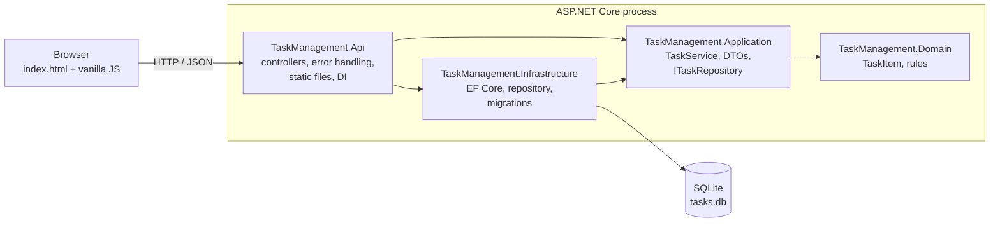
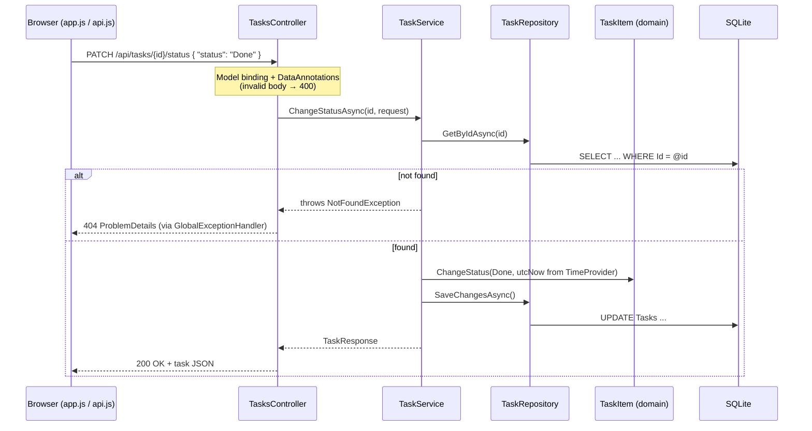

# Architecture

This document describes how the application is structured and why. Requirement IDs (FR, BR, NFR) refer to [requirements.md](requirements.md).

## 1. Overview

The solution is a layered ASP.NET Core application. One process serves both the REST API and the static web frontend, and stores data in a SQLite file.

Dependencies point inward. The domain references nothing. The application layer defines the `ITaskRepository` interface, and the infrastructure layer implements it (dependency inversion), so business rules never depend on EF Core or HTTP (NFR-02).

## 2. Projects and responsibilities

| Project | Responsibility | Key types |
|---|---|---|
| `TaskManagement.Domain` | Business rules and invariants | `TaskItem`, `TaskItemStatus`, `TaskPriority`, `DomainValidationException` |
| `TaskManagement.Application` | Use cases, data contracts, persistence abstraction | `ITaskService` / `TaskService`, `CreateTaskRequest`, `UpdateTaskRequest`, `ChangeTaskStatusRequest`, `TaskResponse`, `ITaskRepository`, `NotFoundException` |
| `TaskManagement.Infrastructure` | Persistence with EF Core and SQLite | `AppDbContext`, `TaskItemConfiguration`, `TaskRepository`, `DatabaseInitializer`, migrations |
| `TaskManagement.Api` | HTTP, composition root, frontend hosting | `TasksController`, `GlobalExceptionHandler`, `Program`, `wwwroot/` |

## 3. Request flow

Example: changing the status of a task.

## 4. Design decisions

Each decision lists the reason and the main trade-off.

| # | Decision | Reason | Trade-off |
|---|---|---|---|
| D1 | .NET 10 (LTS), pinned in `global.json` | Supported until November 2028; every machine and CI use the same SDK. | Requires installing the .NET 10 SDK. |
| D2 | Entity named `TaskItem`, enum `TaskItemStatus` | Avoids clashes with `System.Threading.Tasks.Task` and `TaskStatus`. | Slightly less natural names. |
| D3 | Rich domain entity with private setters | Rules cannot be bypassed; the id cannot change (BR-05) by construction. Validation runs before any mutation, so a failed update leaves the task intact. | EF Core needs a private parameterless constructor. |
| D4 | Validation in two layers | DataAnnotations reject malformed requests at the boundary; the domain enforces the same rules regardless of caller. Limits are shared constants (`TaskItem.TitleMaxLength`). | Some rules are declared twice. |
| D5 | Thin repository interface | Keeps the application layer independent of EF Core and easy to unit test with a hand-written fake. | `DbContext` is already a repository; this adds one small layer. |
| D6 | Time from `TimeProvider`, passed to the domain | Timestamps are deterministic in tests without sleeps or extra libraries. | Callers must pass the time explicitly. |
| D7 | Exceptions mapped centrally to ProblemDetails (`IExceptionHandler`) | Controllers stay free of try/catch; every error has one format (RFC 9457); unexpected errors are logged but never exposed (BR-09). | Uses exceptions for the "not found" path instead of a result type. |
| D8 | GUID identifiers generated by the domain | No database round-trip to obtain an id; ids cannot be guessed by incrementing. | Longer URLs than integer ids. |
| D9 | Enums stored as text in the database | Rows stay readable, and reordering enum members cannot corrupt data. | Slightly larger storage. |
| D10 | Controllers, with content types declared per response | Explicit routing and status codes. Declaring `application/json` per success response keeps error responses as `application/problem+json`. | More attributes than Minimal APIs. |
| D11 | Frontend served from the API's `wwwroot` | Same origin, so no CORS; one process to run and to test. | Frontend and API cannot be deployed independently. |
| D12 | Vanilla JavaScript with ES modules | One screen with a few dialogs does not justify a framework or a build step. `api.js` (HTTP) and `app.js` (UI) keep concerns separate. | Manual DOM code; would not scale to a large UI. |
| D13 | Migrations applied at startup (configurable) | The application is ready to use after `dotnet run`; restarts are safe because only pending migrations run. | Production systems usually migrate in the deployment pipeline instead. |

## 5. Data model

Table `Tasks` (migration `InitialCreate`):

| Column | Type (SQLite) | Constraints | Notes |
|---|---|---|---|
| `Id` | TEXT | Primary key | GUID generated by the domain |
| `Title` | TEXT | Required, max 120 | Trimmed |
| `Description` | TEXT | Optional, max 1000 | `null` when blank |
| `Status` | TEXT | Required, max 20 | `ToDo`, `InProgress`, `Done` |
| `Priority` | TEXT | Required, max 20 | `Low`, `Medium`, `High` |
| `AssignedTo` | TEXT | Optional, max 100 | `null` when blank |
| `CreatedAtUtc` | TEXT | Required | Read back as `DateTimeKind.Utc` by a value converter |
| `UpdatedAtUtc` | TEXT | Required | Same as above |

SQLite does not enforce declared text lengths. The domain is the effective guard, and the lengths still document the schema.

## 6. Error handling

| Situation | Source | HTTP response |
|---|---|---|
| Malformed JSON, unknown enum name, missing required field, length exceeded | ASP.NET Core model validation (`[ApiController]`) | 400 `ValidationProblemDetails`, `application/problem+json` |
| Business rule violated in the domain | `DomainValidationException` → `GlobalExceptionHandler` | 400 `ValidationProblemDetails` with the failing field |
| Unknown id | `NotFoundException` → `GlobalExceptionHandler` | 404 `ProblemDetails` |
| Malformed id or unknown route | Route constraint `{id:guid}` + `UseStatusCodePages` | 404 `ProblemDetails` |
| Any other exception | `GlobalExceptionHandler` | 500 generic `ProblemDetails`; details only in the server log |

The frontend turns these responses into messages next to the invalid fields, or into a page-level message. A 404 is shown as "This task no longer exists", without the raw id.

## 7. Frontend

- `index.html` contains the page structure, three native `<dialog>` elements (form, details, delete confirmation) and a `<template>` for task cards.
- `js/api.js` wraps `fetch` and converts ProblemDetails into an `ApiError` with per-field messages.
- `js/app.js` renders the list, handles events (with event delegation on the list) and manages the dialogs.
- User text is assigned with `textContent`, never `innerHTML` (NFR-06).
- Accessibility: labels, `aria-describedby` and `aria-invalid` for field errors, an `aria-live` message region, a visible focus indicator, a skip link, and focus starting on "Cancel" in the delete dialog (NFR-05).

## 8. Testing architecture

| Suite | Host | Database | Isolation |
|---|---|---|---|
| Unit | None (plain objects) | Hand-written in-memory fake | New objects per test |
| Integration | `WebApplicationFactory` (in-memory server) | SQLite in-memory, real migrations | New host and database per test; controllable clock |
| UI | Compiled API started as a separate process | Temporary SQLite file, deleted afterwards | Fresh browser per test; each test creates its own data |

Details are in the [test plan](test-plan.md).

## 9. Continuous integration

GitHub Actions ([`ci.yml`](../.github/workflows/ci.yml)) runs on every push and pull request to `main`. Job 1 restores, builds in Release, and runs the unit and integration tests. Job 2 runs the Selenium tests in headless Chrome. A summary script fails a job if a suite executed zero tests. Test results (TRX) are uploaded as artifacts.

## 10. Security considerations

- Server-side validation of every input. Enum values are accepted only as names.
- No HTML rendering of user data in the browser.
- Error responses never contain exception details, and JSON parser messages that would reveal internal type names are disabled.
- No authentication: this is a known limitation of the portfolio scope (see [requirements.md](requirements.md#7-out-of-scope)).
